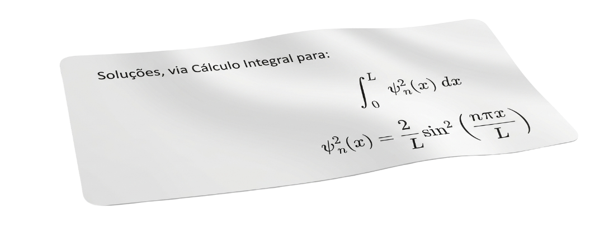
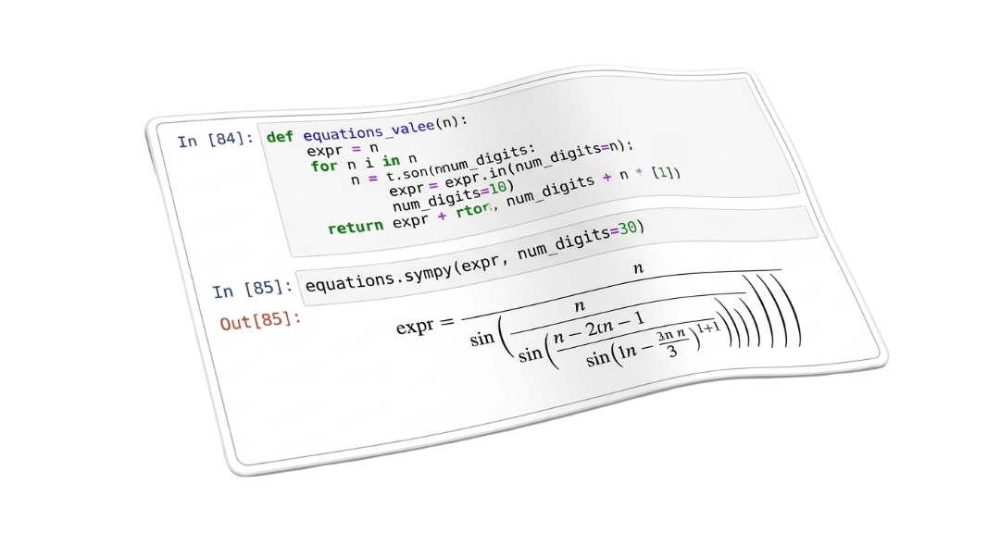
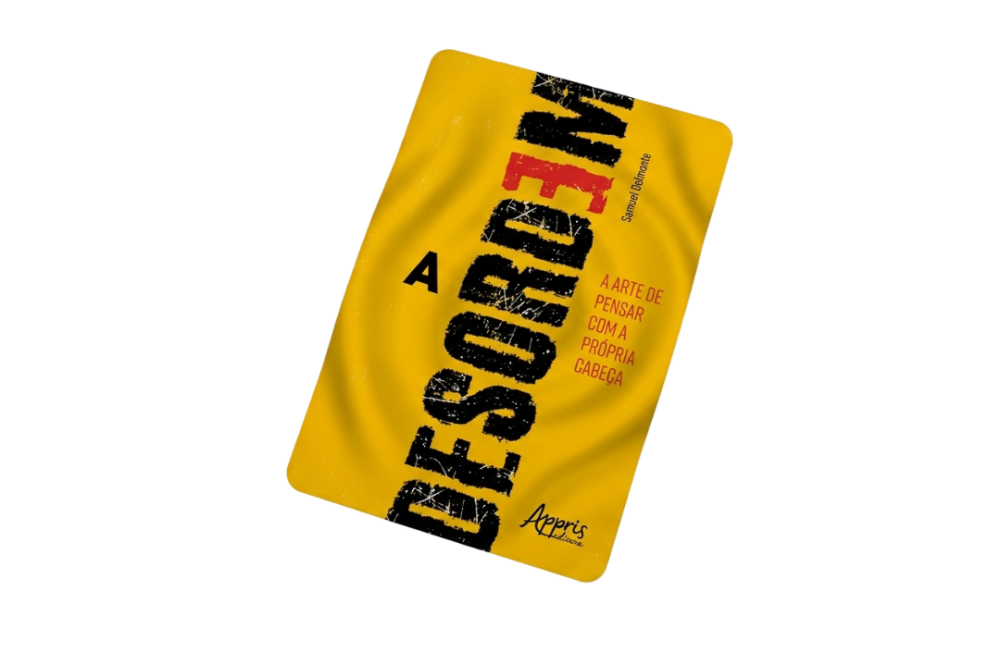

## 👋 Hi, I’m @SamuelDelmonte

   Bacharel em Física com pós-graduação em Inteligência Artificial.  
   Perfil analítico altamente avançado, focado na aplicação do método científico, modelagem estocástica e simulação numérica para a resolução de problemas complexos. 
   Especialista no desenvolvimento de algoritmos de **Machine Learning** e **Deep Learning** com ênfase em IA Interpretável (XAI) e extração de leis analíticas a partir de dados numéricos (**Regressão Simbólica**).  
   Pesquisador em Inteligência Artificial e Física com experiência em modelagem matemática avançada, regressão simbólica (PySR) e aprendizado de máquina interpretável para aplicação em sistemas complexos. 

   
   

---

## 👀 I’m interested in ... 
Interessado em impulsionar inovações científicas que integrem IA e física, por meio das simulações computacionais, resultando
análise de fenômenos quânticos e desenvolvimento de modelos preditivos em Python. 
em soluções transparentes e aplicáveis em múltiplos domínios.

    

## 🌱 I’m currently learning ... 
Focado no aprendizado das técnicas do paradigma da **Regresão Simbólica**.

  
  
  

## 🛠️ Publicações...
### Livro: **A Desordem** - A arte de pensar com a própria cabeça

  
  

 

 

- 💞️ I’m looking to collaborate on ...
- 📫 How to reach me ...

<!---
SamuelDelmonte/SamuelDelmonte is a ✨ special ✨ repository because its `README.md` (this file) appears on your GitHub profile.
You can click the Preview link to take a look at your changes.
--->
